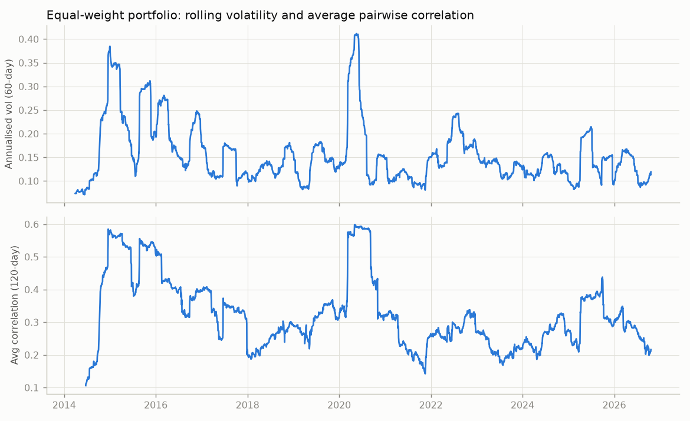
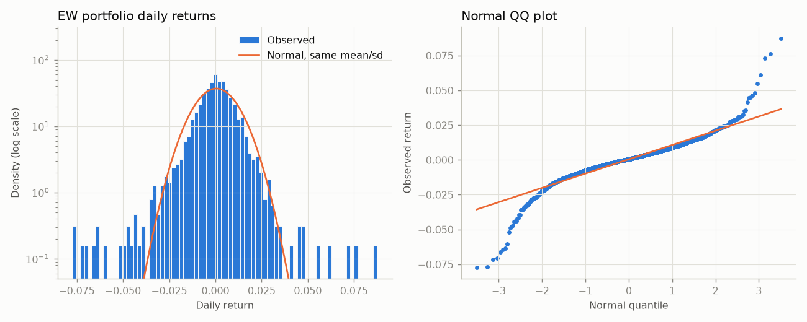
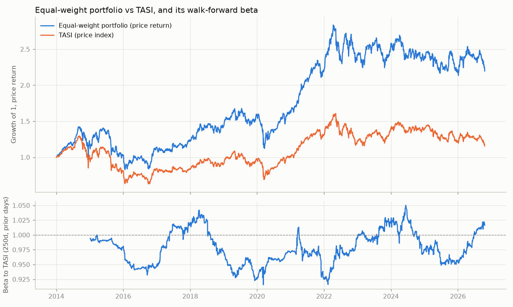
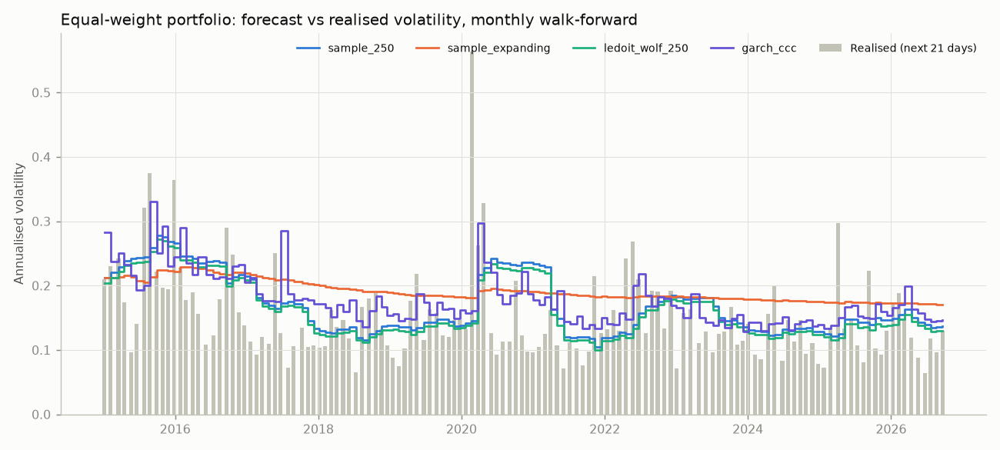
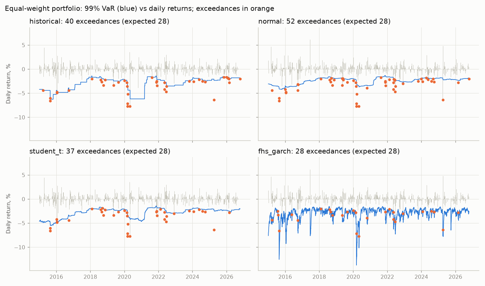
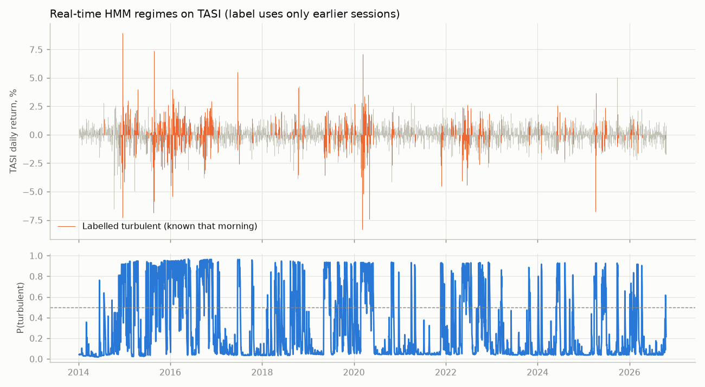
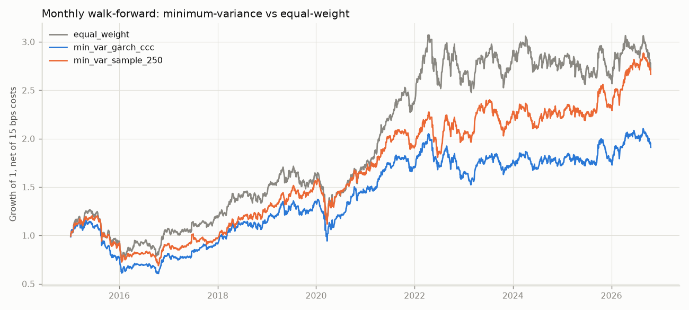

# Tailwise

How well can standard risk models estimate the risk of a Saudi (Tadawul) equity portfolio
out of sample, and where do they fail?

This is a student portfolio project. Results are reported as they come out, including bad ones.

## Summary of findings

Sample: 19 Tadawul stocks, January 2014 to October 2026, with TASI as the benchmark.

- **Simple baselines are hard to beat.** GARCH-CCC ranks first for covariance forecasts on all six
  test portfolios, but its edge over the plain 250-day sample covariance is not statistically
  significant (p = 0.05 to 0.44). Ledoit-Wolf shrinkage makes no practical difference. A
  minimum-variance portfolio built from GARCH does *worse* after costs than one built from the
  sample covariance, because it trades three times as much.
- **Normal VaR fails** (too many breaches, Expected Shortfall too small). Historical and
  Student-t VaR get the overall breach rate roughly right but their breaches cluster, and they
  fail every conditional-coverage test. **Only GARCH-filtered historical simulation (FHS) passes
  every coverage test on every portfolio**, with 28 breaches at 99% where 28.4 were expected.
- **Market regimes from TASI** show where the window-based models fail: in turbulent markets they
  are breached about twice as often as they should be, and in calm markets too rarely. FHS holds
  in both.
- **March 2020 and the 2015–16 shocks are tested out of sample.** In the crash weeks of
  February–March 2020, FHS had 2 breaches of its 99% VaR; the other three models had 5 each.
- **Stress:** the 2014–16 oil-price decline took TASI down 51% and the equal-weight portfolio 41%
  (price terms). No model's one-day 99% VaR, scaled up to a multi-week horizon, was a safe bound
  for the worst episodes.
- **The equal-weight portfolio beat TASI by 5.2 points a year** in price terms, with beta 0.97.
  This is most likely survivorship, equal-weighting, and the absence of Aramco, not skill (see
  Known Limitations).

## Status

| Phase | Content | State |
|---|---|---|
| 1 | Data pipeline and exploratory stats | done |
| 1b | TASI benchmark: relative performance and beta | done |
| 2 | Covariance estimation (sample, Ledoit-Wolf, GARCH) | done |
| 3 | VaR / Expected Shortfall backtests | done |
| 4 | Volatility regimes | done |
| 5 | Historical stress replay, Brent sensitivity | done |
| 6 | Allocation (optional) | done |

## Reproduce

```bash
python -m venv .venv
.venv/Scripts/python -m pip install -r requirements.txt   # Windows; .venv/bin/python elsewhere
.venv/Scripts/python run.py --refresh  # first run on a fresh clone: downloads Yahoo data into data/raw
.venv/Scripts/python run.py            # later runs reuse that cached snapshot
.venv/Scripts/python -m pytest
```

A full run takes about 20 minutes. Raw Yahoo Finance prices are not stored in this repository
(they are downloaded by `--refresh` into `data/raw/`, which git ignores). The committed results
do contain numbers derived from them: daily *portfolio* returns, forecasts, and statistics. A
fresh download may differ slightly from the snapshot behind the committed results (Yahoo revises
history), but it covers the same dates; `--refresh` also re-downloads the Brent series. The TASI
file is included (see Data). Given the same raw data, two full reruns reproduce every output file
byte for byte.

## Data

- **Stocks:** daily prices from Yahoo Finance via `yfinance` (`.SR` tickers), cached as raw CSVs in
  `data/raw/`. Returns are simple daily total returns from Yahoo's dividend- and split-adjusted
  close (`Adj Close`).
- **Benchmark (TASI):** Tadawul All Share Index daily closing levels, 2013-01-01 to 2026-10-20
  (3,443 sessions), in `data/raw/TASI_daily_close_2013-01-01_to_2026-10-20.csv`.
  **Source: Saudi Exchange (Tadawul), historical reports, TASI daily history, retrieved
  2026-10-20. All rights in the data remain with the Saudi Exchange; the file is included only so
  that the results can be reproduced.** **TASI is a price index: dividends are not reinvested.**
  Every comparison with TASI therefore uses the stocks' *price* returns (split-adjusted close, no
  dividends); the risk models use total returns. Yahoo has no usable TASI history (`^TASI.SR`
  returns one bar). Schema, enforced on load and tested: `Date` (YYYY-MM-DD, strictly increasing,
  unique) and `Close` (numeric, positive). The file passes range checks (5,416 to 13,820) and its
  largest daily move is −8.7% on 2020-03-08. Before 29 June 2013 the exchange traded Saturday to
  Wednesday; those sessions are real.
- **Oil:** Brent front-month futures from Yahoo (`BZ=F`), Phase 5 only.
- **Sample:** 2014-01-01 to 2026-10-20 (`START` and `END` in `tailwise/data.py`): 3,087 panel
  dates. The end date is the last session in the TASI file, so a later `--refresh` reproduces this
  sample instead of extending it. Yahoo's Tadawul data before mid-2013 is unusable (fake prices,
  wrong trading week), so 2014 is the earliest clean start.

### Universe (hand-picked)

19 large, liquid stocks with clean Yahoo history over the whole sample:

| Sector | Stocks |
|---|---|
| Petrochemicals | 2010 SABIC, 2020 SABIC Agri-Nutrients, 2310 Sipchem, 2350 Saudi Kayan |
| Materials | 1211 Ma'aden |
| Banks | 1120 Al Rajhi, 1010 Riyad, 1060 SAB, 1150 Alinma, 1140 Albilad, 1080 ANB |
| Telecom & utilities | 7010 stc, 5110 Saudi Electricity |
| Consumer & health | 2280 Almarai, 4190 Jarir, 4002 Mouwasat, 8210 Bupa Arabia |
| Other | 4300 Dar Al Arkan, 4030 Bahri |

Left out, each for a reason found in the data:

| Stock | Reason |
|---|---|
| 2222 Saudi Aramco | Listed 2019-12-11 |
| 1180 Saudi National Bank | Listed 2014-11-12 |
| 2290 Yansab | Yahoo has only zero-volume filler from April to October 2015 |
| 7020 Mobily | Yahoo has only zero-volume filler in June and July 2015 |
| 7030 Zain KSA | Capital reductions in 2015 and 2018 that Yahoo does not adjust (one-day "returns" of +66% and −38%) |
| 2380 Petro Rabigh, 2050 Savola | Capital restructurings that Yahoo's adjustment does not handle cleanly |
| 1050 Banque Saudi Fransi | Long gaps in Yahoo's history |
| 3030 Saudi Cement | Too illiquid |

An earlier version of this project used 24 stocks (with Aramco, SNB, Yansab, Mobily, and Zain)
from Aramco's listing in December 2019. Its out-of-sample tests could not include March 2020 or
the 2014–16 oil decline; this version trades those five stocks for twice the history.

### Cleaning decisions

Every action is written to `data/processed/cleaning_log.csv` with ticker, date, and detail.

| Step | Rule | Why | Effect |
|---|---|---|---|
| Filler rows | Drop rows with zero volume or missing price | Yahoo inserts carried-forward, zero-volume bars on holidays and outages; large caps never really trade zero shares | 1,972 stock-days |
| Spike reversal | Drop a day that moves >10% and reverses by >10% the next day | Bad prints beyond Tadawul's ±10% daily limit | 1 day: Ma'aden 2023-06-08 (+51%, then −34%) |
| Common calendar | Keep only dates on which all 19 stocks have a valid price | One calendar for covariance estimation; the next return then spans the gap for every stock alike | 71 dates dropped |
| TASI join | Inner join with TASI sessions; no forward-fill | Benchmark and stocks on identical dates; removes Yahoo rows on non-trading days | 10 stock dates, 108 TASI sessions dropped |
| Over-limit flag | Log, but keep, any return beyond ±10% | Almost all are returns spanning dropped sessions; deleting real tail events would flatter the risk models | 34 returns (largest 13.7%) |
| Stale prices | Log runs of >5 unchanged closes with real volume | Detects frozen price feeds | 2 runs, both stc (8 days in Dec 2016, 6 in Jun–Jul 2017), kept |

The spike rule looks one day ahead to decide that day *t* was a bad print. It is a data
correction (as a vendor would make), not a model input.

### Calendar alignment

In the sample, TASI has 3,195 sessions. **10 stock dates are dropped** because they are not
Tadawul sessions at all (Yahoo has priced rows on holidays, e.g. 26–29 June 2017), and **108
TASI sessions are dropped** (3.4%) because Yahoo lacks a usable price for at least one stock
(by year: 2014 2, 2015 12, 2016 16, 2017 9, 2018 4, 2019 2, 2020 4, 2021 7, 2022 10, 2023 20,
2024 10, 2025 10, 2026 2). Nothing is forward-filled: 81 returns span more than one session,
most of them two; the longest are 2015-03-08 (9 sessions: Saudi Kayan, Riyad, SAB, and ANB lack
late February 2015) and 2016-05-24 (8 sessions: a market-wide Yahoo gap).

## Phase 1 results: what the data looks like

Full-sample descriptive statistics (`results/phase1/summary_stats.csv`), not used by any model.
Annualised with the panel's 241 observations per calendar year (Known Limitation 18).

- **Volatility:** annualised volatility ranges from 21.2% (stc) to 35.8% (Dar Al Arkan). The
  equal-weight (EW) portfolio runs at 16.7%, well below any single stock: diversification does
  real work here.
- **Correlation:** mean pairwise correlation is 0.34 (0.17 to 0.62). Banks form the tightest block
  (average 0.51; the highest pair is Al Rajhi and Alinma at 0.62), followed by the petrochemicals
  (0.49). Bupa, Mouwasat, Bahri, and Dar Al Arkan are the least connected. The 120-day average
  correlation swung from 0.11 (mid-2014) to 0.60 (May 2020), so a single full-sample correlation
  matrix hides a lot.
- **Fat tails:** every stock rejects normality (Jarque-Bera p ≈ 0). The EW portfolio has excess
  kurtosis 9.0 and skew −0.46: moves beyond 3 standard deviations happen on 1.43% of days versus
  0.27% under a normal. This is a first warning for any normal (parametric) VaR.
- **Volatility clustering:** 60-day EW volatility ranged from about 7% to 41% (peak May 2020).
- **TASI** (price index, same dates): volatility 16.5%, skew −0.69, excess kurtosis 10.4, moves
  beyond 3 standard deviations on 1.46% of days. The market index is as fat-tailed as the
  portfolio.




## Benchmark results: the portfolios against TASI

Price returns on both sides (TASI has no dividends), daily-rebalanced portfolios, 2014-01-01 to
2026-10-20, annualised by calendar time (`results/benchmark/relative_performance.csv`). Beta is
walk-forward: the beta used for day *t* is estimated on the 250 days before *t*. A full-sample
beta is shown for description only.

| Series | Price return p.a. | Volatility | vs TASI p.a. | Tracking error | Correlation | Beta (full sample) | Walk-forward beta range |
|---|---|---|---|---|---|---|---|
| equal_weight | 6.3% | 16.7% | +5.2 | 4.8% | 0.96 | 0.97 | 0.92–1.05 |
| random 1–5 | 6.0% to 7.1% | 16.7–17.6% | +4.9 to +5.9 | 5.4–9.5% | 0.84–0.95 | 0.86–0.99 | 0.68–1.15 |
| TASI | 1.1% | 16.5% | — | — | — | — | — |

- **The portfolios are market portfolios.** Correlation with TASI is 0.84–0.96 and beta is close
  to 1; walk-forward beta for equal-weight stayed between 0.92 and 1.05.
- **Equal-weight beat TASI by 5.2 points a year in price terms, and all five random portfolios
  beat it too.** Do not read this as skill. The 19 stocks were picked in 2026 as survivors with
  clean data; equal-weighting tilts away from the largest companies; and Aramco, a large part of
  TASI since 2019, is not in the universe (its price fell 12% from its listing to 2026-10-20 while
  TASI rose 22%).
- **Dividends matter a lot here.** The equal-weight total return was 9.6% a year against a 6.3%
  price return: about 3.3 points a year come from dividends that TASI does not include.



## Phase 2 results: covariance forecasts

**Setup.** At each origin, one every 21 trading sessions (135 non-overlapping blocks, January
2015 to September 2026), each method forecasts the covariance of the next 21 daily returns using
only data before the origin. The forecast variance of a fixed portfolio is compared with its
realised variance (sum of squared daily returns over the 21 days). The first origin needs 250
days of history, so tests start in January 2015.

| Method | What it is |
|---|---|
| `sample_250` | Sample covariance of the last 250 days |
| `ledoit_wolf_250` | Ledoit-Wolf (2004) shrinkage toward a scaled identity, last 250 days (checked against scikit-learn in the tests) |
| `garch_ccc` | GARCH(1,1) per stock for the 21-day variance, fitted on all data to date; correlation of standardised residuals over the last 250 days |
| `sample_expanding` | Sample covariance of all data to date. A control: GARCH sees all history, so this checks whether its edge is just more data |

Test portfolios: equal-weight plus 5 random long-only portfolios (Dirichlet(1) weights, seed 2026,
saved in `results/phase2/test_portfolios.csv`). Main loss: QLIKE (Patton 2011), which ranks
forecasts correctly even though one block of realised variance is a noisy target. Uncertainty:
Diebold-Mariano test on loss differences against `sample_250`, Newey-West standard errors.

**Equal-weight portfolio** (`results/phase2/evaluation.csv` has all six):

| Method | QLIKE (lower is better) | vs sample_250 (95% CI) | DM p | mean realised / mean forecast | blocks realised > forecast |
|---|---|---|---|---|---|
| garch_ccc | 0.311 | −0.059 (−0.121, +0.002) | 0.06 | 0.84 | 24% |
| sample_250 | 0.371 | — | — | 0.91 | 34% |
| ledoit_wolf_250 | 0.378 | +0.007 (−0.011, +0.025) | 0.44 | 0.98 | 36% |
| sample_expanding | 0.381 | +0.010 (−0.087, +0.108) | 0.84 | 0.75 | 19% |

**What this says**

- **GARCH ranks first on all six portfolios, but the win is not statistically significant.** Its
  QLIKE is about 16% lower than the sample covariance's; the p-values across portfolios run from
  0.05 to 0.44, and no 95% interval excludes zero. Twice the history narrowed the intervals but
  did not settle the question.
- **The GARCH edge comes from shocks.** The largest gains are the blocks starting 2020-02-23
  (the March 2020 crash), 2025-04-06, and 2022-05-24, where GARCH had already raised its forecast
  and the 250-day sample had not.
- **It is not just more data.** The expanding-window sample covariance uses the same history as
  GARCH and ranks last: it never forgets old crises, so it over-forecasts risk by about 25% on
  average.
- **Ledoit-Wolf makes no practical difference here.** With 19 stocks and 250 days the sample
  covariance is already well estimated; the shrinkage intensity averages 8.5%.
- **GARCH over-forecasts on average.** Realised variance averaged 84% of its forecast, and in 76%
  of blocks realised was below forecast; it buys its good QLIKE in shocks with caution in calm
  times.
- **The six test portfolios are nearly one test.** Long-only random weights behave like the
  equal-weight portfolio: their loss differences correlate at 0.76 or more.



## Phase 3 results: VaR and Expected Shortfall backtests

**Setup.** Every trading day from January 2015 (2,836 days), each model forecasts the next
day's 95% and 99% VaR and ES for the six Phase 2 test portfolios, using only earlier returns.
Portfolio weights are held fixed (equivalent to daily rebalancing).

| Model | How the forecast is made |
|---|---|
| `historical` | Empirical quantile of the last 250 daily returns; ES is the mean of the returns beyond it |
| `normal` | Normal distribution with the mean and standard deviation of the last 250 days |
| `student_t` | Student-t fitted by maximum likelihood to the last 250 days |
| `fhs_garch` | Filtered historical simulation: GARCH(1,1) on the portfolio return (refitted every 21 days, volatility updated daily) scaled by the empirical quantile of all standardised residuals to date |

Backtests: exceedance count against the expected 5% / 1%, Kupiec unconditional coverage test,
Christoffersen independence test (are exceedances clustered?), conditional coverage (both),
and an ES check: on exceedance days, is the realised loss larger than the forecast ES on average
(one-sided t-test, McNeil-Frey style)? Full results in `results/phase3/backtest.csv`.

**Equal-weight portfolio**

| Model | Level | Exceedances (expected) | Kupiec p | Independence p | Cond. coverage p | Realised loss / forecast ES |
|---|---|---|---|---|---|---|
| historical | 95% | 145 (142) | 0.78 | **<0.001** | **<0.001** | 1.02 |
| historical | 99% | **40 (28)** | **0.039** | **0.018** | **0.007** | 1.05 |
| normal | 95% | 123 (142) | 0.10 | **<0.001** | **<0.001** | **1.24** |
| normal | 99% | **52 (28)** | **<0.001** | **<0.001** | **<0.001** | **1.31** |
| student_t | 95% | 148 (142) | 0.60 | **<0.001** | **<0.001** | 1.03 |
| student_t | 99% | 37 (28) | 0.12 | **0.012** | **0.013** | 1.05 |
| fhs_garch | 95% | 143 (142) | 0.92 | **0.037** | 0.11 | 0.98 |
| fhs_garch | 99% | 28 (28) | 0.95 | 0.46 | 0.76 | 0.96 |

Bold: rejected at 5%. Across all six portfolios, conditional coverage is rejected for historical,
normal, and Student-t VaR on **all six portfolios at both levels**, and for FHS-GARCH on none.

**What this says**

- **The normal model fails, as Phase 1 predicted.** At 99% it is breached 1.7–2.0% of the time on
  every portfolio, and when it is breached the loss is 22–32% larger than its ES forecast (ES
  rejected on all six portfolios at both levels). Fat tails break it.
- **Fat tails alone fix the count but not the timing.** Student-t gets the 99% rate close
  (1.2–1.4%) and its ES holds, but its breaches cluster: independence is rejected on all six
  portfolios at both levels. A fixed 250-day window cannot react when volatility jumps.
- **Historical simulation has the same clustering problem**, and at 99% it is breached too often
  (1.3–1.5%): with 250 observations its 99% quantile rests on the 2–3 worst days of the past year.
- **FHS-GARCH is the only model that passes.** Its breach rates are 4.7–5.3% and 0.8–1.1% across
  portfolios, its ES ratio is 0.95–1.01, and conditional coverage is never rejected (independence
  at 95% is rejected once, on the EW portfolio, p = 0.04).
- **What changed with the longer sample.** On the earlier 2019–2026 sample FHS looked too
  conservative at 99% (0.5–0.6% breaches). With residuals from 2014 and a test period that
  includes 2015–16 and 2020, its 99% rate is right. The earlier result was a short-sample effect.
- **March 2020, out of sample:** from 20 February to 31 March 2020, FHS had 2 breaches of its 99%
  VaR on the EW portfolio; historical, normal, and Student-t had 5 each.



**Bug found and fixed during this phase:** scipy's default Student-t fit sometimes stopped at a
worse local optimum (degrees of freedom below 2), producing one-day spikes in the t VaR. The fit
now starts from two points and keeps the higher likelihood (tested). This is a numerical fix,
not a model change.

## Phase 4 results: where the models fail, by market regime

**Setup.** Regimes are defined on the market, TASI, not on the test portfolios. A 2-state
Gaussian hidden Markov model (HMM) runs on TASI daily returns on TASI's own calendar since 2013,
refitted every 21 sessions on all TASI history to date (best of 5 seeded starts). The label for
day *t* is the predicted probability of the turbulent state given TASI returns **before** *t*
only: a risk manager could have known it that morning. Day *t* is "turbulent" when that
probability is above 0.5. Cross-check: a simple threshold (trailing 21-session TASI volatility
above its own median to date). Tests check both labelings for lookahead.

Since 2014, the HMM labels 25% of TASI sessions turbulent, with 2015 and 2016 the most turbulent
years. In the Phase 3 test period it labels 760 of 2,836 days (27%) turbulent. The threshold
labels 51%; the two agree on 73% of test days.



**VaR exceedance rate by TASI-HMM regime, EW portfolio** (`results/phase4/var_by_regime_*.csv`)

| Model | 95% calm (exp. 5%) | 95% turbulent | 99% calm (exp. 1%) | 99% turbulent |
|---|---|---|---|---|
| historical | **4.0%** | **8.3%** | 1.2% | **2.1%** |
| normal | **3.3%** | **7.2%** | 1.3% | **3.2%** |
| student_t | **3.9%** | **8.9%** | 1.0% | **2.2%** |
| fhs_garch | 5.2% | 4.7% | 1.0% | 1.1% |

2,076 calm days, 760 turbulent days. Bold: Kupiec test rejects at 5%. Across all six portfolios,
historical, normal, and Student-t VaR are rejected in the turbulent regime on all six at both
levels; at 95% in calm markets they are also rejected on most portfolios (4–6 of 6), for too
*few* breaches. FHS-GARCH is rejected on none, in either regime.

**What this says**

- **The window-based models are wrong in both directions.** In turbulent markets they are
  breached on 7–9% of days instead of 5%, and 2–3% instead of 1%; in calm markets they are too
  cautious (3–4% at 95%). Their aggregate Phase 3 rates look closer to right only because the two
  errors partly cancel.
- **FHS-GARCH holds in both regimes** (5.2% and 4.7% at 95%, 1.0% and 1.1% at 99%), because its
  volatility updates daily.
- **Fat tails are not the fix; reaction speed is.** Student-t is no better than historical in
  turbulent periods.
- **The threshold cross-check agrees.** On its turbulent days the window models run at 2.0–2.7%
  at 99% for equal-weight and are rejected on all six portfolios; FHS-GARCH runs at 1.5% and is
  never rejected there (it is rejected at 99% in calm on two portfolios, for too few breaches).
- **For covariance forecasts, GARCH-CCC has the lowest QLIKE in every regime split**: on the HMM
  split (38 turbulent blocks, 97 calm) 0.23 vs 0.30 for the sample covariance in turbulent blocks
  and 0.34 vs 0.40 in calm ones; the threshold split agrees. The 250-day sample covariance
  under-forecasts turbulent blocks (realised/forecast 1.07) and over-forecasts calm ones (0.82).

## Phase 5 results: stress replay and oil sensitivity

### Historical episodes

The worst non-overlapping 10- and 21-trading-day windows for the equal-weight (EW) portfolio are
found in the data, then replayed on all six test portfolios (`results/phase5/episodes.csv`).
The "context" column is my annotation of widely reported events, not something derived from the
data. For episodes after the first year, the last column compares the loss with the 1-day 99% VaR
each model forecast the day before the episode started, scaled by √days (which assumes
independent days; with volatility clustering this understates multi-day risk). TASI's loss over
the same dates and the EW price loss predicted from its walk-forward beta to TASI are also in
`episodes.csv`.

| Window | Dates | EW loss | Random portfolios | TASI (price) | Context | Loss ÷ scaled 99% VaR (FHS / hist / normal / t) |
|---|---|---|---|---|---|---|
| 21d | 2015-07-27 → 08-24 | 23.9% | 21–23% | 24.5% | Global sell-off of August 2015 after China's devaluation, with oil falling | 2.22 / 1.18 / 1.48 / 1.15 |
| 21d | 2020-02-20 → 03-23 | 22.8% | 20–24% | 24.8% | COVID onset and the OPEC+ price war | 1.83 / 2.16 / 2.33 / 2.22 |
| 10d | 2015-08-11 → 08-24 | 20.0% | 18–20% | 20.5% | same as August 2015 above | 1.68 / 1.43 / 1.75 / 1.37 |
| 10d | 2020-02-23 → 03-09 | 19.9% | 16–21% | 21.1% | same as March 2020 above | 2.44 / 2.73 / 2.95 / 2.82 |
| 21d | 2015-12-21 → 2016-01-20 | 19.1% | 16–17% | 21.2% | Oil below $30 in January 2016 | 0.87 / 0.79 / 1.05 / 0.84 |
| 21d | 2014-11-18 → 12-16 | 18.9% | 15–20% | 21.1% | Oil collapse after OPEC's November 2014 decision not to cut output | no model yet |
| 10d | 2016-01-05 → 01-20 | 18.3% | 16–18% | 19.6% | same as January 2016 above | 1.66 / 1.31 / 1.67 / 1.39 |
| 10d | 2014-12-03 → 12-16 | 15.0% | 13–16% | 16.2% | same as December 2014 above | no model yet |
| 21d | 2014-09-10 → 10-16 | 13.3% | 11–14% | 14.4% | Start of the 2014 oil-price decline | no model yet |
| 10d | 2016-09-18 → 10-03 | 11.8% | 12–17% | 12.3% | Saudi public-sector pay cuts announced in late September 2016 | 1.22 / 0.96 / 1.18 / 1.05 |

- **2015–16 was as severe as March 2020.** The August 2015 and January 2016 sell-offs cost the
  portfolio 18–24%, the same range as March 2020 (20–23%), and eight of the ten worst windows fall
  in 2014–16.
- **No model's scaled 99% VaR was a safe bound.** Of the seven episodes with a forecast, the scaled
  99% VaR was exceeded in six for FHS-GARCH, five for historical, seven for normal, and six for
  Student-t, often by a factor of 1.5 to 3. FHS, the best one-day model, is no better here: these
  are sharp falls arriving from calm conditions, and √days scaling of a one-day forecast does not
  capture them.
- **TASI fell more than the portfolio in all ten episodes** (price terms). For the seven episodes
  with a pre-episode beta, beta × TASI's loss predicted the EW price loss to within 1.7 points
  each time.
- **Diversification barely helps in a stress episode.** The random portfolios lose about the same
  as equal-weight in every episode; in March 2020 the worst stocks were banks, not oil names.

### The 2014–16 oil-price decline

From TASI's peak on 2014-09-09 to its trough on 2016-10-03 (512 sessions), TASI fell 51.4% and
Brent fell 50.5% over the same dates (Brent's own peak-to-trough, June 2014 to January 2016, was
−75.8%). Over the same dates the **equal-weight portfolio fell 41.0% in price terms and 37.5%
with dividends** (`results/phase5/oil_decline_2014_16.csv`). This is a slow, two-year bear market:
its worst windows are in the table above, and the rest is a long grind that one-day risk models
are not built to describe.

TASI's own worst windows since 2013 (`results/phase5/tasi_episodes.csv`):

| Rank | TASI's worst 10 sessions since 2013 | TASI's worst 21 sessions since 2013 |
|---|---|---|
| 1 | 2016-01-04 → 01-17: −20.6% | 2020-02-24 → 03-23: −25.0% |
| 2 | 2015-08-11 → 08-24: −20.5% | 2015-07-27 → 08-24: −24.5% |
| 3 | 2020-03-04 → 03-17: −19.2% | 2015-12-23 → 2016-01-20: −22.5% |
| 4 | 2014-12-03 → 12-16: −16.2% | 2014-11-18 → 12-16: −21.1% |
| 5 | 2016-09-18 → 10-02: −11.8% | 2014-09-10 → 10-16: −14.4% |

### Oil sensitivity (Brent)

Weekly returns, Tadawul Thursday-to-Thursday paired with Brent Wednesday-to-Wednesday (Brent
settles after Tadawul closes), 633 weeks. Brent is Yahoo's continuous front-month future `BZ=F`.
Full table: `results/phase5/oil_betas.csv`.

- **Oil explains little of the week-to-week risk.** EW portfolio oil beta 0.12 (95% CI 0.09–0.16),
  R² 8.5%: a 10% Brent drop goes with about a 1.2% portfolio drop on average.
- **Oil exposure is broad, not just energy.** The highest betas are petrochemicals (Sipchem 0.25,
  Saudi Kayan 0.22, SABIC 0.20); banks sit at 0.10–0.16; stc and Bahri are near zero.
- **The market's oil link has weakened.** TASI's weekly oil beta was 0.18 (SE 0.03) from 2014 to
  December 2019, against 0.11 (SE 0.02) after it. Oil explains about 10% of weekly TASI moves in
  both halves.

**Scenario** (Brent weekly moves that actually occurred in the sample; full-sample beta):

| Brent weekly shock | Predicted EW move (95% CI) |
|---|---|
| −30.5% (worst week, March 2020) | −3.8% (−2.8% to −4.8%) |
| −14.1% (1st percentile week) | −1.7% (−1.3% to −2.2%) |
| −8.0% (5th percentile week) | −1.0% (−0.7% to −1.3%) |

**The scenario number is not reliable.** The two worst Brent weeks were almost identical (−30.0%
and −30.5%, March 2020), but the EW portfolio fell 11.6% in the first and only 2.5% in the
second. A linear oil beta cannot capture that. Out of sample (betas estimated only on earlier
weeks, 529 weeks from February 2016), predicted and actual weekly returns correlate at 0.26; in
the six worst Brent weeks the portfolio fell in four and rose in two.

## Phase 6 results: minimum-variance allocation

**Setup.** Same 135 rebalance dates as Phase 2 (one every 21 trading sessions, 2015-01-06 to
2026-09-20; the portfolios are held to 2026-10-20, about 11.8 years). At each date, a long-only,
fully invested minimum-variance portfolio is built from the GARCH-CCC covariance (top-ranked in
Phase 2) and, as a control, from the 250-day sample covariance, using only earlier returns.
Weights drift with prices between rebalances; trading costs are 15 bps per unit traded (roughly
Tadawul's commission; spreads and market impact are ignored), with 0 and 30 bps as sensitivity.
Returns are total returns, annualised with the 241 observations per calendar year of this period.
Differences against equal-weight carry 95% intervals from a 21-day moving-block bootstrap.
Full results: `results/phase6/performance.csv`.

| Strategy (15 bps) | Return p.a. | Volatility p.a. | Max drawdown | Turnover per rebalance | Effective no. of stocks |
|---|---|---|---|---|---|
| equal_weight | 8.9% | 16.3% | 40.3% | 5% | 19 |
| min_var_sample_250 | 8.7% | 14.7% | 42.8% | 22% | 5.4 |
| min_var_garch_ccc | 5.7% | 14.6% | 47.5% | 65% | 6.0 |

Volatility vs equal-weight: −1.6 points for the sample version and −1.7 for GARCH, 95% CI about
(−2.2, −1.1): **significant**. Return vs equal-weight: −0.2 points for sample (CI −5.0 to +4.2)
and −3.2 for GARCH (CI −7.7 to +0.9): **not significant at 15 bps**; at 30 bps the GARCH
shortfall (−4.3 points, CI −8.8 to −0.2) is significant.



**What this says**

- **Minimum variance lowers volatility but not drawdown.** It cuts volatility by about 1.6
  points, a reduction the bootstrap says is real, yet both minimum-variance portfolios fell
  further than equal-weight in the 2015–16 decline (43% and 48% vs 40%). Low past volatility did
  not mean small losses in a two-year bear market.
- **The better covariance forecast makes a worse portfolio.** GARCH-CCC gives the same volatility
  as the sample covariance but trades three times as much (65% vs 22% of the portfolio per
  rebalance), because its volatility forecasts move every month. After costs it returns 3.0
  points a year less than the sample version and has the deepest drawdown.
- **The portfolios are concentrated.** About 45% of stock-dates get zero weight; on average the
  largest position is about a third of the portfolio, and Jarir averages 17–18%, followed by stc,
  Bahri, SABIC Agri-Nutrients, and Riyad Bank. Effective diversification is 5–6 stocks. A real
  mandate would cap weights; this test does not.

### How the equal-weight figures in this README differ

The same 19 stocks give different "equal-weight returns" in different sections because they
measure different things:

| Where | Figure | Return type | Rebalancing | Period |
|---|---|---|---|---|
| Benchmark | 6.3% | price (no dividends), to compare with TASI | daily | 2014-01-01 to 2026-10-20 |
| Benchmark | 9.6% | total | daily | 2014-01-01 to 2026-10-20 |
| Phase 6 | 8.9% | total, net of 15 bps costs | every 21 sessions, weights drift between | 2015-01-06 to 2026-10-20 |

Phase 6 starts a year later because the first allocation needs 250 days of history.

## Known Limitations

Kept up to date as the project goes.

1. **Survivorship bias.** The universe is hand-picked in 2026 from stocks that survived, stayed
   liquid, and have clean data from 2014 to 2026. Delisted, merged, or collapsed names are
   excluded, which likely understates realised risk and flatters performance: the equal-weight
   portfolio's 5.2-point annual lead over TASI should be read in that light.
2. **The universe is not the market.** Saudi Aramco and Saudi National Bank, two of the largest
   companies, are excluded because they listed after the start date, and Yansab, Mobily, and Zain
   KSA for Yahoo data problems. TASI is cap-weighted and, since 2019, dominated by Aramco; the
   19-stock equal-weight portfolio is a different, smaller-cap-tilted portfolio.
3. **Data vendor.** Yahoo Finance data for Tadawul is free and unofficial. Data before mid-2013 is
   unusable. Checked against TASI's official calendar, Yahoo lacks a usable price for at least one
   stock on 108 of 3,195 sessions (3.4%), and has priced rows on 10 days that were not Tadawul
   sessions. Returns after a missing session span it (81 returns, up to 9 sessions), which
   inflates measured tail risk on those days.
4. **Volume data is unreliable.** Yahoo's volume for some stocks drops to a few hundred shares for
   weeks at a time (e.g. Ma'aden May–June 2023), so no cleaning rule here relies on volume, other
   than treating zero volume as a non-trading filler row.
5. **Adjustment accuracy.** Total returns rely on Yahoo's dividend and split adjustments. Zain KSA
   was excluded for unadjusted capital reductions; the remaining stocks pass the spike and
   daily-limit checks, but a wrong adjustment that stays within the limit would not be caught, and
   pre-2019 adjustments were not checked against a second source. Two stale-price runs in stc (2016
   and 2017) are logged and kept.
6. **The first part of the 2014 decline is not tested out of sample.** Every rolling test needs 250
   days of history, so tests start in January 2015; September–December 2014 is estimation data only.
7. **Few independent observations.** 135 non-overlapping 21-session blocks in Phase 2; the
   differences between covariance methods are still within statistical noise. Long-only random
   portfolios add little independent evidence because they are highly correlated with equal-weight.
8. **Phase 2 design choices** (not tuned to results): 250-day window, 21-day horizon, GARCH(1,1)
   with normal quasi-likelihood, constant correlation instead of DCC, identity shrinkage target
   instead of constant correlation.
9. **Phase 3 design choices** (not tuned to results): 250-day window for historical, normal, and
   t models; FHS uses all standardised residuals since January 2014; GARCH parameters refitted
   every 21 days.
10. **The ES test is weak.** It is a one-sided t-test on the exceedance days and only detects ES
    that is too small; an ES that is too large shows only in the ratio.
11. **Real-time regime labels lag.** The label uses only earlier TASI sessions, so the first day
    of a shock arriving from calm conditions is labelled calm. The turbulent regime measures how
    models behave once turbulence is visible, not at its onset.
12. **Regime splits are still thin at 99%.** 760 TASI-turbulent test days and 38 turbulent blocks;
    the 99% turbulent results rest on 8–24 breaches per model.
13. **Stress episodes are chosen with hindsight** (worst windows in the data). That is intended for
    a replay, but they are not a forecast of the next crisis. The 2019 Abqaiq attack is in the
    sample but is not among the worst windows and is not studied separately.
14. **Episode labels are annotations.** The "context" column summarises widely reported events and
    is not tested against the data.
15. **Oil betas are unstable and linear.** Brent explains about 8–10% of weekly variance, the same
    oil shock produced very different equity moves, and front-month futures have roll jumps.
16. **Allocation test simplifications.** No weight caps (portfolios concentrate in 5–6 stocks),
    costs are commission only, no taxes or Zakat, no cash or risk-free rate.
17. **Price index vs total return.** TASI excludes dividends, so all benchmark comparisons use
    price returns. Saudi dividend yields are high (about 3.3 points a year for the equal-weight
    portfolio here), so comparing a total-return portfolio with TASI would overstate it.
18. **Annualisation.** Daily statistics are annualised with the number of observations per
    calendar year (about 241), not the usual 250, because returns that span sessions Yahoo lacks
    still cover real time (limitation 3). The axis of the Phase 2 chart of forecast vs realised
    volatility still uses 250; it is display only and no reported number depends on it.
19. **One TASI source.** The TASI file is a single static export from the Saudi Exchange. It passes
    the schema and range checks above, but was not cross-checked against a second source.

## License

Code: MIT (see `LICENSE`). The TASI data file remains the property of the Saudi Exchange (see Data).
